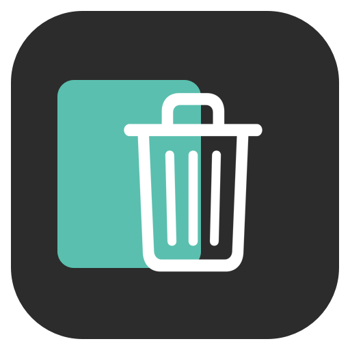
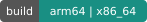
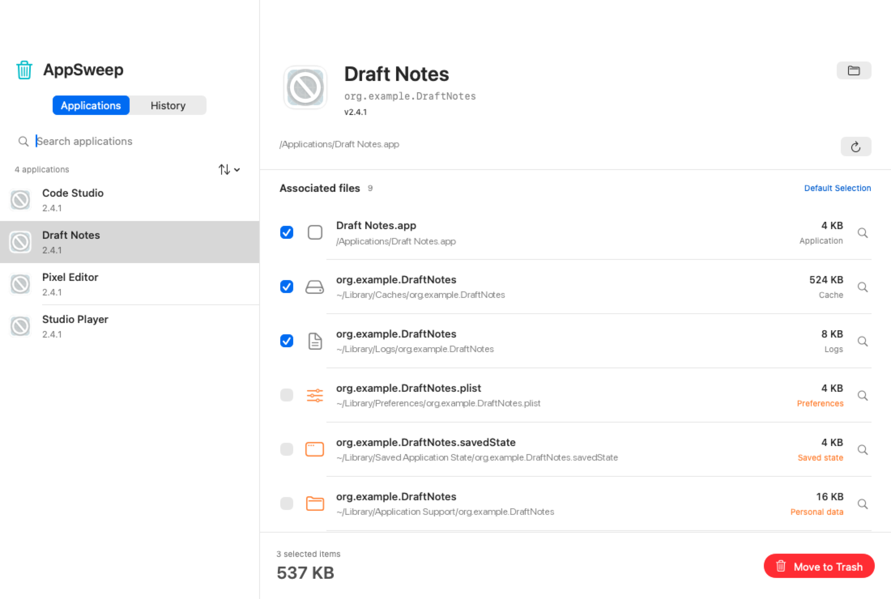
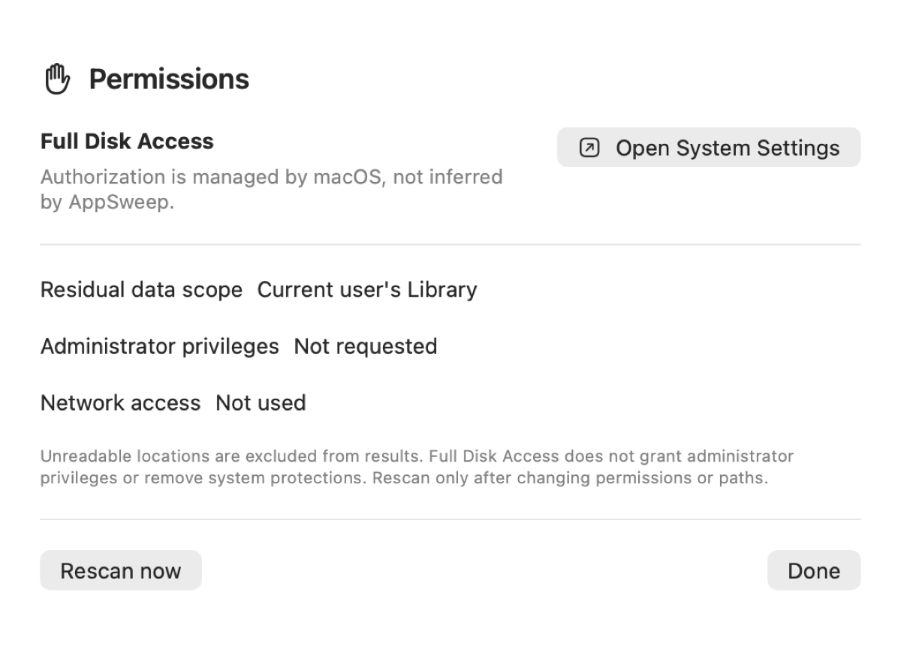
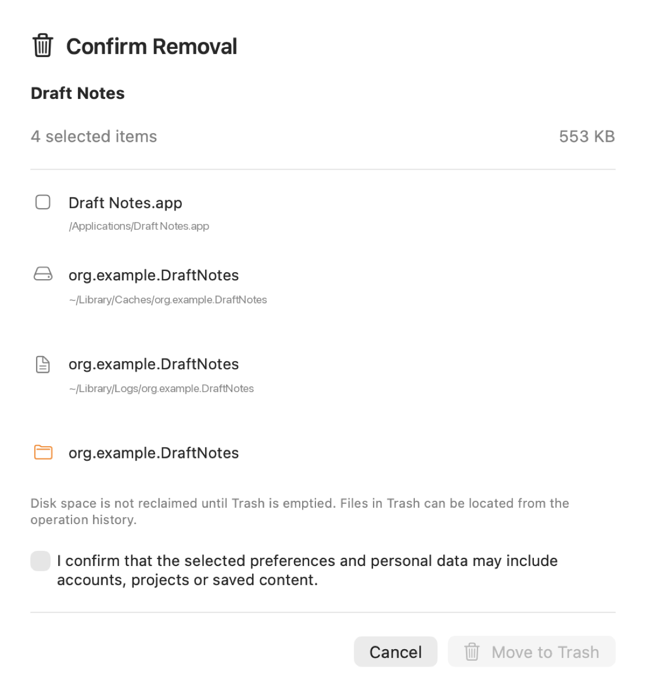
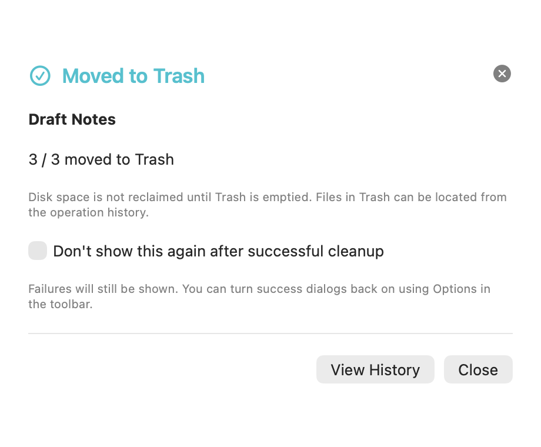

<p align="center">
  
</p>

<h1 align="center">AppSweep</h1>

<p align="center"><strong>Uninstall apps. Review what they leave behind.</strong></p>

<p align="center">
  <a href="#build-locally"></a>
  <a href="#build-locally"></a>
  <a href="Package.swift"></a>
  <a href="VERSION"></a>
</p>

<p align="center">
  <a href="https://github.com/zealerFT/AppSweep/actions/workflows/ci.yml"></a>
</p>

<p align="center"><strong>English</strong> · <a href="README.zh-CN.md">简体中文</a></p>

<p align="center">
  <strong><a href="https://github.com/zealerFT/AppSweep/releases/download/v0.2.0/AppSweep-0.2.0-universal.dmg">Download for macOS — v0.2.0 preview</a></strong><br />
  macOS 13+ · Apple Silicon &amp; Intel · No compilation required<br />
  <a href="https://github.com/zealerFT/AppSweep/releases/tag/v0.2.0">Release notes and checksums</a>
</p>

<p align="center">
  <a href="#screenshots">Screenshots</a> ·
  <a href="#install-and-first-use">Getting started</a> ·
  <a href="#build-locally">Build from source</a> ·
  <a href="PRIVACY.md">Privacy</a>
</p>

AppSweep is a native macOS application cleanup utility. It finds associated caches, logs, preferences, saved state, application support data, containers, and web data by Bundle ID, then moves the items you approve to the macOS Trash.

Built with **SwiftUI and AppKit**, with no third-party package dependencies. AppSweep works **offline**, with Chinese and English interfaces.

The current source is **0.2.1, not yet released**; the downloadable preview is **0.2.0**. Ad-hoc signed preview updates can invalidate privacy grants even when their switches remain enabled. Consistent signing across distributed updates requires a fixed signing certificate. These previews have not been validated as a final release on every supported configuration.

## Screenshots

These screenshots use an isolated sample application and fictional paths. They contain no real files or personal data.



<table>
  <tr>
    <td></td>
    <td></td>
  </tr>
  <tr>
    <td align="center">Permissions</td>
    <td align="center">Removal confirmation</td>
  </tr>
  <tr>
    <td colspan="2"></td>
  </tr>
  <tr>
    <td colspan="2" align="center">Items are moved to Trash and remain available in operation history</td>
  </tr>
</table>

## Features

- Scans applications in `/Applications` and `~/Applications`, with search, sorting, and drag and drop support.
- Sorts by app size (largest or smallest first) and last use (oldest or newest first), and remembers the selected order. The list shows app-bundle disk usage and macOS last-use records; unknown values stay at the end.
- Matches associated files by an exact Bundle ID instead of guessing from the display name.
- Selects the application bundle, caches, and logs by default. Preferences, containers, and personal data require an explicit selection.
- Rechecks application state, file ownership, and file identity before moving anything.
- Moves approved items to the macOS Trash rather than deleting them permanently. The operation history records their original and Trash locations.
- Lets you close the cleanup result without opening history. Select **Don't show this again after successful cleanup** to remember that choice; use the toolbar's **Options** menu to restore dialogs. Failures still appear, and history is saved either way.
- Provides Chinese and English UI with support for the system dark appearance.
- Explains permission scope through macOS System Settings. It does not elevate privileges or change SIP, Gatekeeper, or TCC settings.

## Install and first use

1. [Download AppSweep-0.2.0-universal.dmg](https://github.com/zealerFT/AppSweep/releases/download/v0.2.0/AppSweep-0.2.0-universal.dmg). The same installer includes Apple Silicon and Intel binaries for macOS 13 or later.
2. Open the `.dmg` and drag **AppSweep** to **Applications**.
3. Launch AppSweep from Applications. No Xcode, terminal commands, or compilation are required.

Choose the `.dmg` asset on [GitHub Releases](https://github.com/zealerFT/AppSweep/releases/tag/v0.2.0); **Source code (zip/tar.gz)** is for developers.

**First launch:** this preview is ad-hoc signed, without Apple Developer ID signing or notarization. If macOS cannot verify the developer, confirm that you downloaded it from this repository, then go to **System Settings → Privacy & Security → Open Anyway** and confirm **Open**. This option normally appears after an attempted launch; managed Macs may prevent it.

To scan protected locations in the current user's Library:

1. Open **Permissions** from the toolbar.
2. Choose **Open System Settings**.
3. In **Privacy & Security → Full Disk Access**, add the `AppSweep.app` that you are currently running and enable it.
4. Relaunch AppSweep if macOS requests it, then choose **Rescan now**.

The unreleased 0.2.1 build asks Finder to move an app to Trash if direct recycling is denied. macOS handles permission to use Finder and any administrator confirmation; cancelling leaves subsequent selected data in place. This flow is awaiting verification with an installed app and is not in the published 0.2.0 download. With ad-hoc updates, an old grant may no longer match the new program. Keeping the Bundle ID unchanged does not resolve that mismatch.

When the app itself is selected, it is moved first. If macOS refuses or the user cancels, the selected associated data stays in place. Errors and skipped items remain visible in the result and History.

The normal cleanup flow is:

1. Select an application in the left sidebar and wait for its associated files to finish scanning.
2. Review every path, type, and size. Check preferences, containers, and personal data carefully before selecting them.
3. Choose **Move to Trash**, then review the confirmation panel.
4. After completion, open **History** to see each result and locate items in Trash.

For a step-by-step Chinese guide, see [docs/USER_GUIDE.zh-CN.md](docs/USER_GUIDE.zh-CN.md).

## Scan limitations and notices

**Scan limitations** mean that a scan may have missed content. Typical causes are unreadable directories, symbolic links, incomplete size estimates, shared Bundle IDs, or a background service that requires the vendor's official uninstaller.

**Scan notices** mean that AppSweep safely skipped a non-standard or damaged application bundle. They do not mean that Full Disk Access is broken and do not require repeated authorization. Use the application's official uninstaller or Finder when it needs special handling.

The refresh button in the toolbar reloads the application list and rescans the selected application. The circular arrow beside an application path rescans only that application. Rescan after changing a permission or path, rather than to dismiss a notice that describes an unsupported application.

## Safety boundaries

AppSweep does not promise to remove every trace of every application. The current version does not:

- Guess file ownership from an application's display name.
- Clean shared Group Containers, Keychain items, system directories, other users' directories, or external disks.
- Bypass administrator authorization, system protections, or privacy controls.
- Handle every vendor-specific installer and background component.

If AppSweep detects login items, background services, system extensions, drivers, security software, or matching launchd jobs, it blocks direct cleanup and points you to the vendor's official uninstaller. Shared data is protected when multiple installed copies use the same Bundle ID.

Moving an item to Trash does not free disk space until Trash is emptied. Before emptying Trash, use History to locate an item and restore it from Finder if needed.

## Privacy

AppSweep runs locally. It has no account system, analytics, advertising, network client, cloud storage, or automatic update service. It reads application metadata, supported Library paths, and file attributes; it does not upload file contents. Operation history may contain application names, Bundle IDs, and local paths. See [PRIVACY.md](PRIVACY.md) before sharing history or screenshots.

## Build locally

Requirements: macOS 13 or later, Swift 6, and Xcode Command Line Tools.

The build script can target Apple Silicon (`arm64`) and Intel (`x86_64`). Intel runtime testing is still pending; the build targets badge describes packaging capability.

```bash
git clone https://github.com/zealerFT/AppSweep.git
cd AppSweep
swift run AppSweepSafetyChecks
bash scripts/build.sh
open dist/AppSweep.app
bash scripts/dmg.sh
```

`scripts/build.sh` works without an Apple account. It creates one private local signing identity under `~/Library/Application Support/AppSweep Build/Signing` and reuses it for later builds. Do not delete this folder between updates. The build keychain is locked and removed from the keychain search list after signing; system trust settings are not changed. Output goes to the Git-ignored `dist/` folder. Updates in the same output folder are checked against the previous signing identity; use `PREVIOUS_APP` to check another existing bundle. The script does not replace or launch the installed app. Switching from an old ad-hoc build to this local identity can require a one-time renewal of macOS privacy grants. Local builds are not notarized; `ALLOW_ADHOC_SIGNING=1` remains available for disposable previews.

To run the isolated UI smoke test:

Local builds also check an existing locally signed `/Applications/AppSweep.app` with the same Bundle ID, so deleting build output does not remove the update identity check.

```bash
ALLOW_ADHOC_SIGNING=1 CONFIGURATION=debug OUT_DIR="$PWD/build/qa-app" bash scripts/build.sh
build/qa-app/AppSweep.app/Contents/MacOS/AppSweep \
  --qa-smoke "$PWD/build/qa" -AppleLanguages '(en)'
```

The core safety checks are independent of third-party packages:

```bash
swift run AppSweepSafetyChecks
```

## Distribution outside the App Store

The downloadable preview is built by [GitHub Actions](.github/workflows/release.yml) from a matching `vX.Y.Z` tag. The workflow checks `VERSION`, runs the safety checks, builds both architectures, verifies the app and disk image, and publishes a **prerelease** with `SHA256SUMS.txt` and `build-info.json`. The latter records the source commit, which is also embedded in the app's `Info.plist`. Published installers use `io.github.zealerft.AppSweep` as their Bundle ID. Prepare `docs/releases/vX.Y.Z.md` before tagging; update download links only after the release assets exist.

For a release with a verified developer identity and notarization, the distributor must provide an Apple Developer Program account, a Developer ID certificate, and a `notarytool` keychain profile. The signed release script remains separate from the preview workflow:

```bash
export DEVELOPER_ID_APPLICATION='Developer ID Application: Your Organization (TEAMID)'
export APP_BUNDLE_ID='io.github.zealerft.AppSweep'
export NOTARY_PROFILE='your-keychain-profile-name'
export APP_VERSION='0.2.1'
bash scripts/release.sh
```

Before a public release, test on Apple Silicon, Intel, and the minimum supported macOS version. Verify Gatekeeper, permission persistence, and the cleanup flow on a clean system. Update `VERSION`, commit the change, and create a matching `vX.Y.Z` tag before building the release package. Do not publish an unsigned local test package as the production installer.

## Project structure

```text
Sources/AppSweepCore/       scanning, file safety, and Trash operations
Sources/AppSweep/            SwiftUI/AppKit interface and localizations
Tests/AppSweepCoreTests/     isolated core safety checks
docs/                        user guide and development documentation
packaging/                   App Bundle Info.plist template
scripts/                     build, DMG, icon, and release scripts
VERSION                      default build and release version
```

## License

An open-source license has not been selected for this repository yet.
