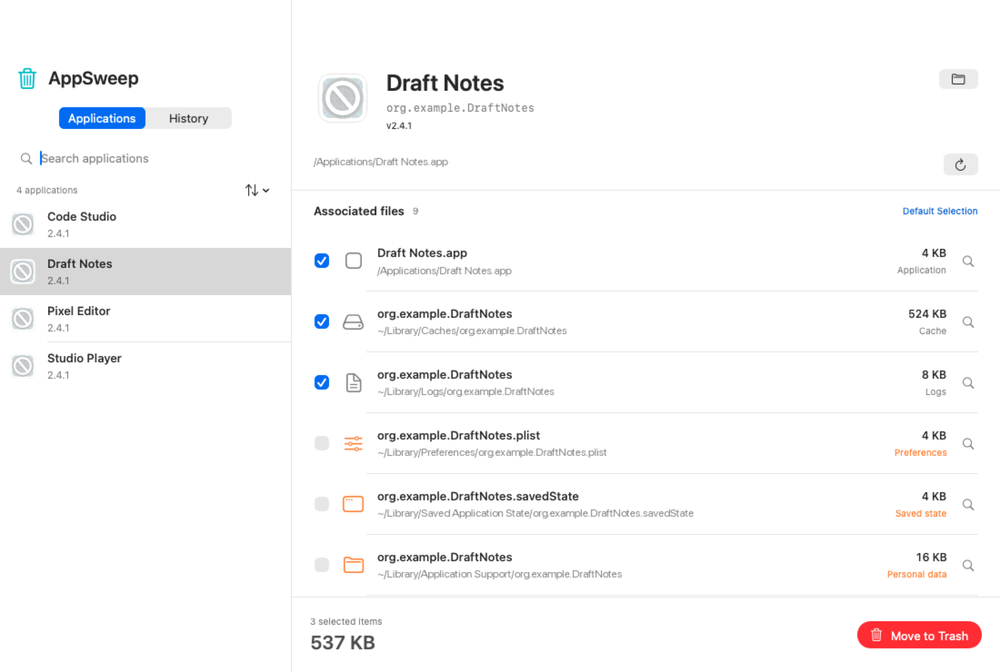
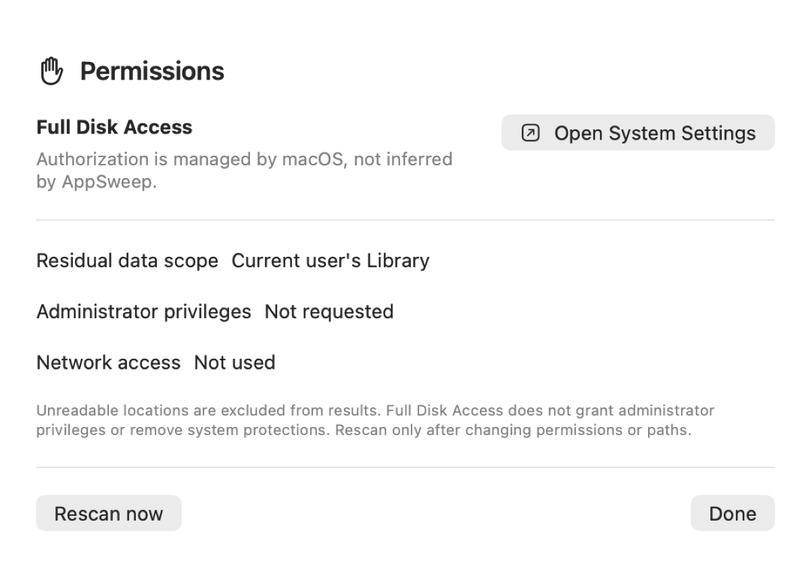
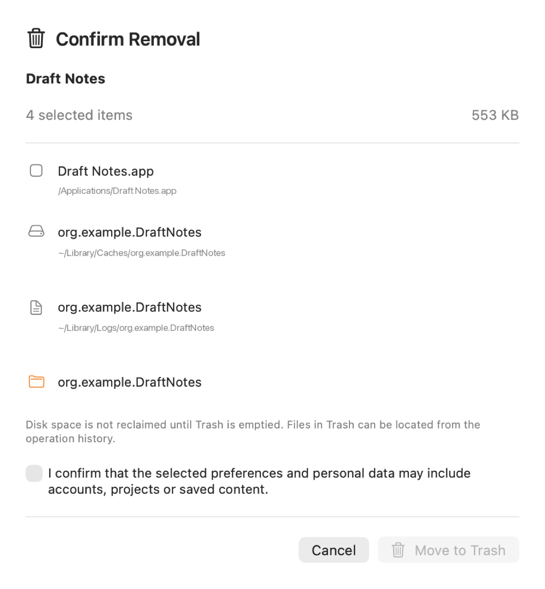
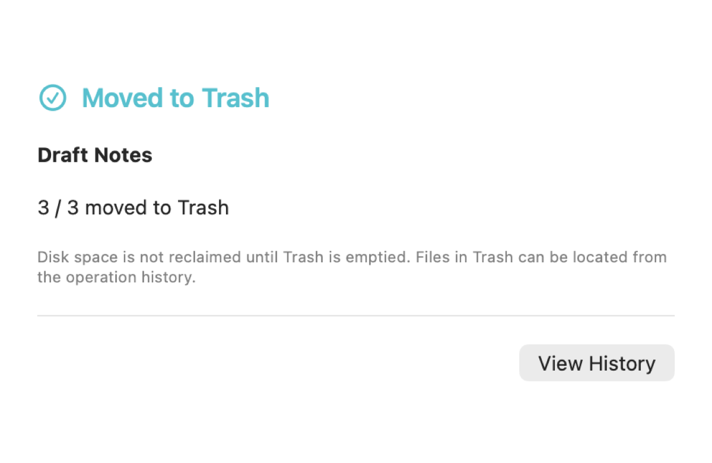

# AppSweep

[简体中文 README](README.zh-CN.md)

AppSweep is a native macOS application cleanup utility. It finds associated caches, logs, preferences, saved state, application support data, containers, and web data by Bundle ID, then moves the items you approve to the macOS Trash.

[](https://github.com/zealerFT/AppSweep/actions/workflows/ci.yml)

The current version is **0.1.0 prerelease**. It is intended for testing and feedback. It has not yet been validated as a final release on every supported macOS version, Intel Mac, or clean system configuration.

GitHub shows `README.md` as the repository landing page and does not switch README files automatically by visitor location. The Chinese version is available in [README.zh-CN.md](README.zh-CN.md).

## Screenshots

These screenshots use an isolated sample application and fictional paths. They contain no real files or personal data.



<table>
  <tr>
    <td></td>
    <td></td>
  </tr>
  <tr>
    <td align="center">Permissions</td>
    <td align="center">Removal confirmation</td>
  </tr>
  <tr>
    <td colspan="2"></td>
  </tr>
  <tr>
    <td colspan="2" align="center">Items are moved to Trash and remain available in operation history</td>
  </tr>
</table>

## Features

- Scans applications in `/Applications` and `~/Applications`, with search, sorting, and drag and drop support.
- Matches associated files by an exact Bundle ID instead of guessing from the display name.
- Selects the application bundle, caches, and logs by default. Preferences, containers, and personal data require an explicit selection.
- Rechecks application state, file ownership, and file identity before moving anything.
- Moves approved items to the macOS Trash rather than deleting them permanently. The operation history records their original and Trash locations.
- Provides Chinese and English UI with support for the system dark appearance.
- Explains permission scope through macOS System Settings. It does not elevate privileges or change SIP, Gatekeeper, or TCC settings.

## Install and first use

After a release is published, download the `.dmg` from [GitHub Releases](https://github.com/zealerFT/AppSweep/releases), open it, and drag `AppSweep.app` to the Applications folder. Launch it from Applications.

macOS may ask you to confirm the developer or grant file access on first launch. Continue only after verifying that the download came from a trusted source. To scan protected locations in the current user's Library:

1. Open **Permissions** from the toolbar.
2. Choose **Open System Settings**.
3. In **Privacy & Security → Full Disk Access**, add the `AppSweep.app` that you are currently running and enable it.
4. Return to AppSweep and choose **Rescan now**.

AppSweep does not request administrator privileges. Full Disk Access is managed by macOS and does not remove system protections.

The normal cleanup flow is:

1. Select an application in the left sidebar and wait for its associated files to finish scanning.
2. Review every path, type, and size. Check preferences, containers, and personal data carefully before selecting them.
3. Choose **Move to Trash**, then review the confirmation panel.
4. After completion, open **History** to see each result and locate items in Trash.

For a step-by-step Chinese guide, see [docs/USER_GUIDE.zh-CN.md](docs/USER_GUIDE.zh-CN.md).

## Scan limitations and notices

**Scan limitations** mean that a scan may have missed content. Typical causes are unreadable directories, symbolic links, incomplete size estimates, shared Bundle IDs, or a background service that requires the vendor's official uninstaller.

**Scan notices** mean that AppSweep safely skipped a non-standard or damaged application bundle. They do not mean that Full Disk Access is broken and do not require repeated authorization. Use the application's official uninstaller or Finder when it needs special handling.

The refresh button in the toolbar reloads the application list and rescans the selected application. The circular arrow beside an application path rescans only that application. Rescan after changing a permission or path, rather than to dismiss a notice that describes an unsupported application.

## Safety boundaries

AppSweep does not promise to remove every trace of every application. The current version does not:

- Guess file ownership from an application's display name.
- Clean shared Group Containers, Keychain items, system directories, other users' directories, or external disks.
- Bypass administrator authorization, system protections, or privacy controls.
- Handle every vendor-specific installer and background component.

If AppSweep detects login items, background services, system extensions, drivers, security software, or matching launchd jobs, it blocks direct cleanup and points you to the vendor's official uninstaller. Shared data is protected when multiple installed copies use the same Bundle ID.

Moving an item to Trash does not free disk space until Trash is emptied. Before emptying Trash, use History to locate an item and restore it from Finder if needed.

## Privacy

AppSweep runs locally. It has no account system, analytics, advertising, network client, cloud storage, or automatic update service. It reads application metadata, supported Library paths, and file attributes; it does not upload file contents. Operation history may contain application names, Bundle IDs, and local paths. See [PRIVACY.md](PRIVACY.md) before sharing history or screenshots.

## Build locally

Requirements: macOS 13 or later, Swift 6, and Xcode Command Line Tools.

```bash
git clone https://github.com/zealerFT/AppSweep.git
cd AppSweep
swift run AppSweepSafetyChecks
bash scripts/build.sh
open dist/AppSweep.app
bash scripts/dmg.sh
```

`scripts/build.sh` reads the repository's `VERSION` file, builds a local package for the current architecture, and applies an ad hoc signature. It is not notarized. Build output is written to `dist/` and is ignored by Git.

To run the isolated UI smoke test:

```bash
CONFIGURATION=debug OUT_DIR="$PWD/build/qa-app" bash scripts/build.sh
build/qa-app/AppSweep.app/Contents/MacOS/AppSweep \
  --qa-smoke "$PWD/build/qa" -AppleLanguages '(en)'
```

The core safety checks are independent of third-party packages:

```bash
swift run AppSweepSafetyChecks
```

## Distribution outside the App Store

A public download outside the App Store still needs Developer ID Application signing and notarization. The distributor must provide an Apple Developer Program account, a Developer ID certificate, a stable reverse-DNS Bundle ID, and a `notarytool` keychain profile.

```bash
export DEVELOPER_ID_APPLICATION='Developer ID Application: Your Organization (TEAMID)'
export APP_BUNDLE_ID='com.yourcompany.AppSweep'
export NOTARY_PROFILE='your-keychain-profile-name'
export APP_VERSION='0.1.0'
bash scripts/release.sh
```

Before a public release, test on Apple Silicon, Intel, and the minimum supported macOS version. Verify Gatekeeper, permission persistence, and the cleanup flow on a clean system. Update `VERSION`, commit the change, and create a matching `vX.Y.Z` tag before building the release package. Do not publish an unsigned local test package as the production installer.

## Project structure

```text
Sources/AppSweepCore/       scanning, file safety, and Trash operations
Sources/AppSweep/            SwiftUI/AppKit interface and localizations
Tests/AppSweepCoreTests/     isolated core safety checks
docs/                        user guide and development documentation
packaging/                   App Bundle Info.plist template
scripts/                     build, DMG, icon, and release scripts
VERSION                      default build and release version
```

## License

No license has been selected yet. Add an appropriate license file and copyright attribution before distributing the repository. Do not copy third-party icons, artwork, or code without permission.
