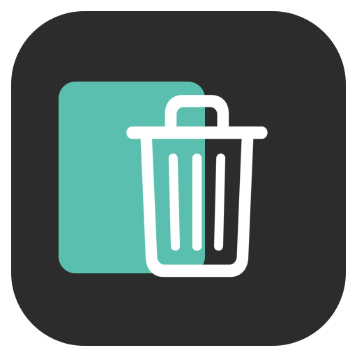
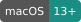
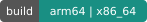
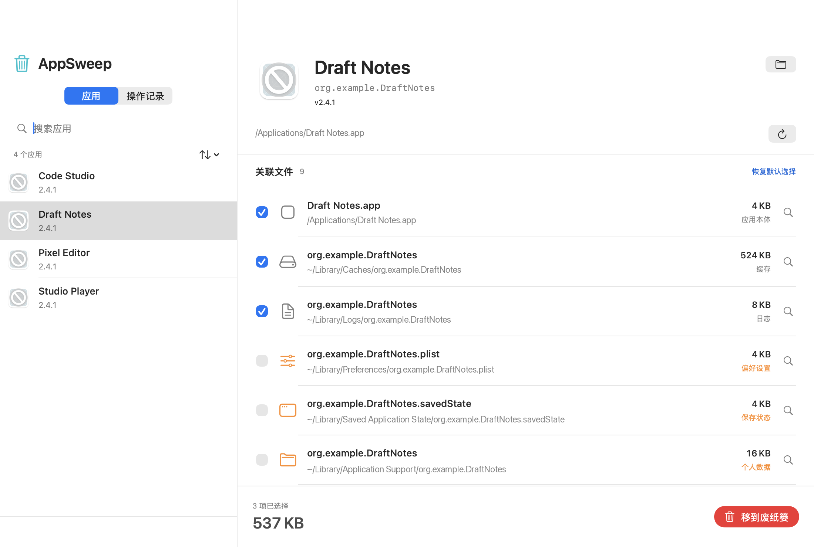
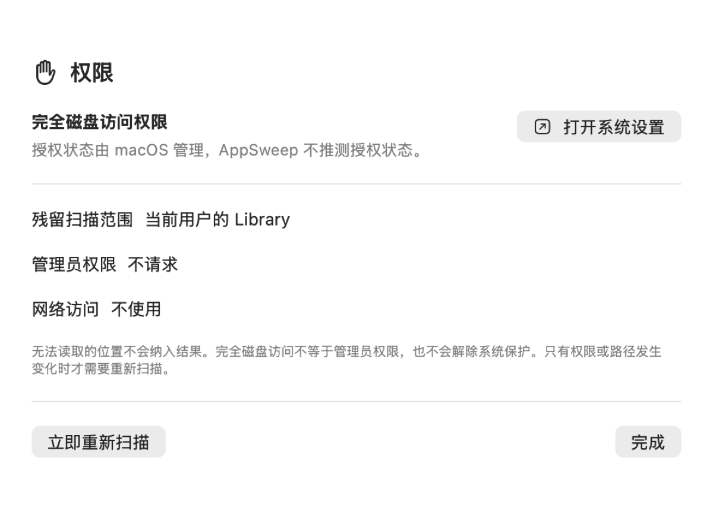
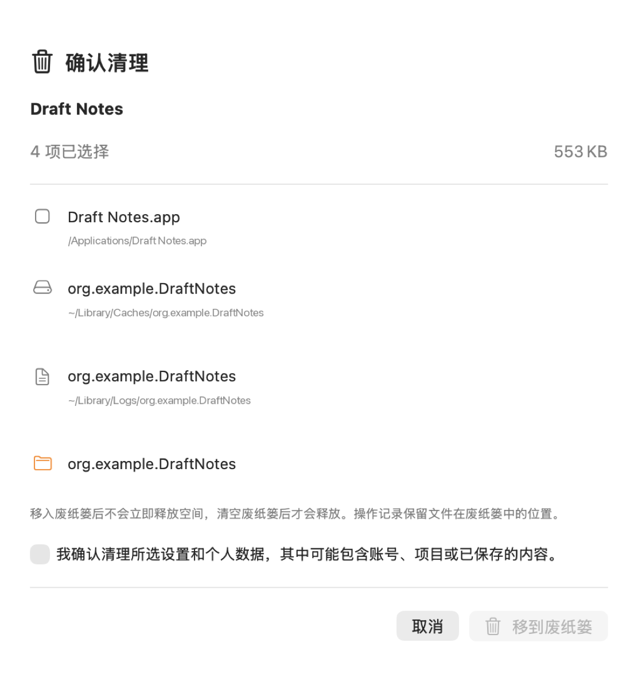
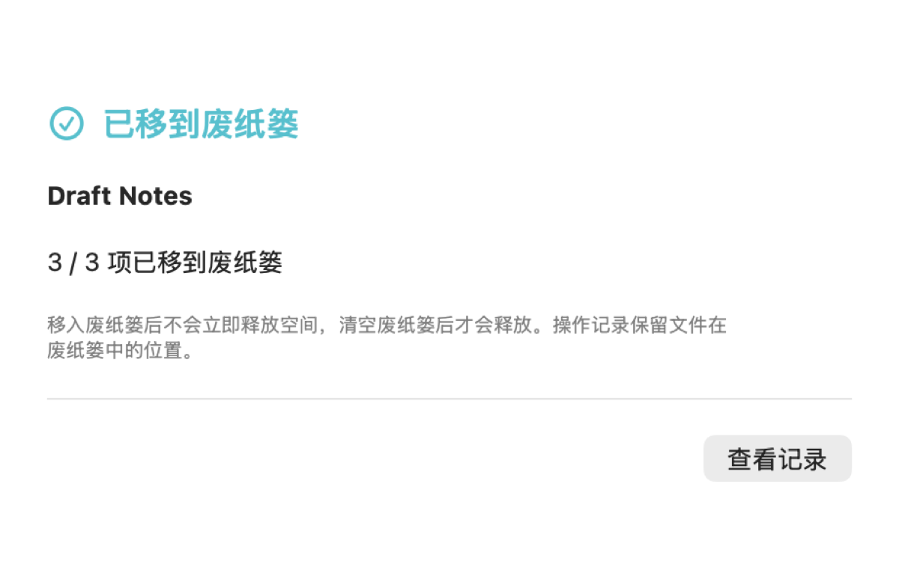

<p align="center">
  
</p>

<h1 align="center">AppSweep</h1>

<p align="center"><strong>卸载应用，也看清它留下的文件。</strong></p>

<p align="center">
  <a href="#本地构建"></a>
  <a href="#本地构建"></a>
  <a href="Package.swift"></a>
  <a href="VERSION"></a>
</p>

<p align="center">
  <a href="https://github.com/zealerFT/AppSweep/actions/workflows/ci.yml"></a>
</p>

<p align="center"><a href="README.md">English</a> · <strong>简体中文</strong></p>

<p align="center">
  <strong><a href="https://github.com/zealerFT/AppSweep/releases/download/v0.1.0/AppSweep-0.1.0-universal.dmg">下载 macOS 安装包 — v0.1.0 预发布版</a></strong><br />
  macOS 13 及以上 · Apple Silicon 与 Intel 通用 · 无需编译<br />
  <a href="https://github.com/zealerFT/AppSweep/releases/tag/v0.1.0">更新说明与校验文件</a>
</p>

<p align="center">
  <a href="#界面预览">界面预览</a> ·
  <a href="#安装和首次使用">开始使用</a> ·
  <a href="#本地构建">源码构建</a> ·
  <a href="docs/USER_GUIDE.zh-CN.md">操作手册</a> ·
  <a href="PRIVACY.md">隐私说明</a>
</p>

AppSweep 是一款原生 macOS 应用清理工具。它按应用的 Bundle ID 查找关联的缓存、日志、偏好设置、保存状态、应用支持目录、容器和网页数据，并把用户确认的项目移到 macOS 废纸篓。

采用 **SwiftUI 和 AppKit** 开发，无第三方包依赖。应用**离线运行**，提供中文和英文界面。

当前版本是 **0.1.0 预发布版**。它适合测试和反馈，尚未代表已经完成所有 macOS 版本、Intel 设备和干净系统环境验收的正式发行版。

## 界面预览

下面的截图使用隔离的示例应用和虚构路径，不包含真实文件或个人数据。



<table>
  <tr>
    <td></td>
    <td></td>
  </tr>
  <tr>
    <td align="center">权限面板</td>
    <td align="center">清理确认</td>
  </tr>
  <tr>
    <td colspan="2"></td>
  </tr>
  <tr>
    <td colspan="2" align="center">清理完成后进入废纸篓，操作记录仍可查看</td>
  </tr>
</table>

## 功能

- 扫描 `/Applications` 和 `~/Applications` 中的应用，支持搜索、排序和拖入应用。
- 按明确的 Bundle ID 匹配关联文件，不按显示名称猜测归属。
- 默认选择应用本体、缓存和日志；偏好设置、容器和个人数据需要用户主动勾选。
- 清理前重新检查应用是否运行、文件归属和文件身份，避免误删已变化的路径。
- 只移到 macOS 废纸篓，不直接永久删除；操作记录保存在本机，便于找回位置。
- 中文和英文界面，支持系统深色外观。
- 权限面板只引导 macOS 系统设置，不自动提权，也不修改 SIP、Gatekeeper 或 TCC。

## 安装和首次使用

1. [下载 AppSweep-0.1.0-universal.dmg](https://github.com/zealerFT/AppSweep/releases/download/v0.1.0/AppSweep-0.1.0-universal.dmg)。一个安装包包含 Apple Silicon 和 Intel 两种架构，要求 macOS 13 或更高版本。
2. 双击打开 `.dmg`，将 **AppSweep** 拖到 **Applications（应用程序）**。
3. 从“应用程序”文件夹打开 AppSweep，无需安装 Xcode、运行命令或自行编译。

在 [GitHub Releases](https://github.com/zealerFT/AppSweep/releases/tag/v0.1.0) 页面选择 `.dmg` 即可；**Source code (zip/tar.gz)** 是给开发者使用的源码。

**首次打开提示：** 此预发布版使用 ad-hoc 签名，尚未经过 Apple Developer ID 签名和公证。如果 macOS 提示无法验证开发者，请先确认文件来自本仓库，再打开 **系统设置 → 隐私与安全性 → 仍要打开**，并确认“打开”。该按钮通常在尝试启动后才会出现；受组织管理的 Mac 可能不允许打开。

需要扫描当前用户 Library 中受保护的目录时，在“系统设置 → 隐私与安全性 → 完全磁盘访问权限”中允许 AppSweep。按 macOS 提示重新打开应用后，再点击“立即重新扫描”。

普通清理流程如下：

1. 在左侧选择应用，等待关联文件扫描完成。
2. 检查每一行的路径、类型和大小；涉及偏好设置、容器或个人数据时，先确认内容确实可以删除。
3. 点击“移到废纸篓”，在确认窗口检查选中数量和大小。
4. 完成后可在“操作记录”中查看每个项目的结果和废纸篓位置。

更完整的步骤、限制和故障排查见 [中文操作手册](docs/USER_GUIDE.zh-CN.md)。

## 如何理解扫描提示

“扫描限制”只表示这次扫描可能遗漏内容，例如无法读取的目录、符号链接、大小估算不完整、共享 Bundle ID 或需要官方卸载器的后台服务。

“扫描提示”表示 AppSweep 安全跳过了非标准或已经损坏的应用包。这类提示不需要用户反复授权，也不会影响其它标准应用的扫描；如果需要处理该软件，请使用它自己的卸载器或在访达中处理。

右上角的刷新按钮会重新读取应用列表，并在已有选中应用时重新扫描它的关联文件。应用详情中路径右侧的圆形箭头只重新扫描当前应用。

## 安全边界

AppSweep 不是“所有残留一键清零”工具。当前版本不会：

- 按应用显示名称猜测文件归属；
- 清理共享 Group Containers、钥匙串、系统目录、其他用户目录或外置磁盘；
- 绕过管理员权限、系统保护或文件访问授权；
- 处理所有厂商自定义的安装方式。

检测到登录项、后台服务、系统扩展、驱动、安全软件或匹配的 launchd 任务时，AppSweep 会阻止直接清理并提示使用官方卸载程序。多个已安装副本共用一个 Bundle ID 时，共享数据也会被保护。

移到废纸篓不会立即释放磁盘空间；清空废纸篓后才会释放。清空前可以通过操作记录定位文件并从访达恢复。

## 隐私

AppSweep 在本机运行，没有账号、分析、广告、网络客户端、云存储或自动更新服务。它只读取应用元数据、支持的 Library 路径和文件属性，不上传文件内容。操作记录可能包含应用名称、Bundle ID 和本机路径，详见 [PRIVACY.md](PRIVACY.md)。

## 本地构建

要求：macOS 13 或更高版本、Swift 6 工具链和 Xcode Command Line Tools。

构建脚本支持 Apple Silicon（`arm64`）和 Intel（`x86_64`）。Intel 真机运行验证仍待完成，页头的架构徽章表示构建能力。

```bash
git clone https://github.com/zealerFT/AppSweep.git
cd AppSweep
swift run AppSweepSafetyChecks
bash scripts/build.sh
open dist/AppSweep.app
bash scripts/dmg.sh
```

`scripts/build.sh` 默认读取仓库根目录的 `VERSION`，生成当前架构的本地测试包，使用 ad-hoc 签名，未公证。构建产物位于 `dist/`，不会被提交到 Git，因为 `.gitignore` 已排除 `.build/`、`build/` 和 `dist/`。

运行隔离 UI QA：

```bash
CONFIGURATION=debug OUT_DIR="$PWD/build/qa-app" bash scripts/build.sh
build/qa-app/AppSweep.app/Contents/MacOS/AppSweep \
  --qa-smoke "$PWD/build/qa" -AppleLanguages '(zh-Hans)'
```

核心安全检查使用独立的 Swift 测试程序，不依赖第三方包：

```bash
swift run AppSweepSafetyChecks
```

## 正式分发

当前可下载的预发布版由 [GitHub Actions](.github/workflows/release.yml) 从对应的 `vX.Y.Z` 标签构建。流程会核对 `VERSION`、运行安全检查、构建两种架构、验证应用和磁盘映像，再发布为 **Pre-release**，附上 `SHA256SUMS.txt` 和 `build-info.json`。后者记录源码提交，应用的 `Info.plist` 中也保存该提交。公开安装包统一使用 `io.github.zealerft.AppSweep` 作为 Bundle ID。以后发布新版本时，先准备对应的 `docs/releases/vX.Y.Z.md` 并更新下载链接，再打标签。

如需可验证开发者身份、经过公证的正式版本，发布者需要自己的 Apple Developer Program 账号、Developer ID 证书和 `notarytool` 钥匙串 profile。正式签名脚本与预发布流程分开：

```bash
export DEVELOPER_ID_APPLICATION='Developer ID Application: Your Organization (TEAMID)'
export APP_BUNDLE_ID='io.github.zealerft.AppSweep'
export NOTARY_PROFILE='your-keychain-profile-name'
export APP_VERSION='0.1.0'
bash scripts/release.sh
```

正式发布前还要在 Apple Silicon、Intel 和最低支持的 macOS 版本上测试，并在干净系统上验证 Gatekeeper、权限持久性和卸载流程。更新 `VERSION` 后提交并创建同名的 `vX.Y.Z` Git tag，再从该 tag 构建正式包。不要把未经公证的本地测试包当作正式安装包。

## 项目结构

```text
Sources/AppSweepCore/       扫描、文件安全和移入废纸篓的核心逻辑
Sources/AppSweep/            SwiftUI/AppKit 界面和本地化资源
Tests/AppSweepCoreTests/     隔离的核心安全检查
docs/                        操作手册和开发维护文档
packaging/                   App Bundle 的基础 Info.plist
scripts/                     构建、DMG、图标和正式发布脚本
VERSION                      构建和发布的默认版本号
```

## 许可证

本仓库暂未指定开源许可证。
